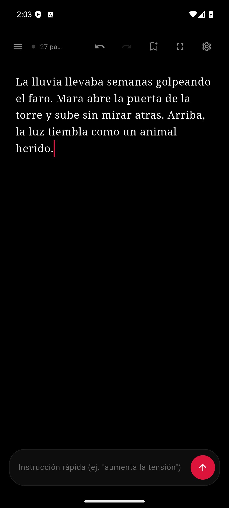
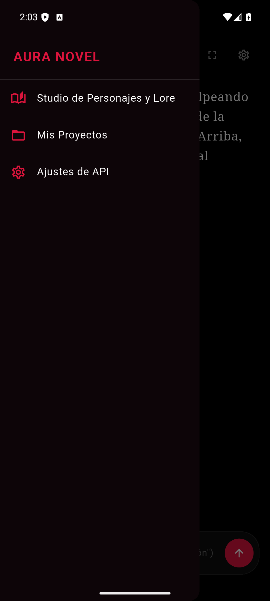
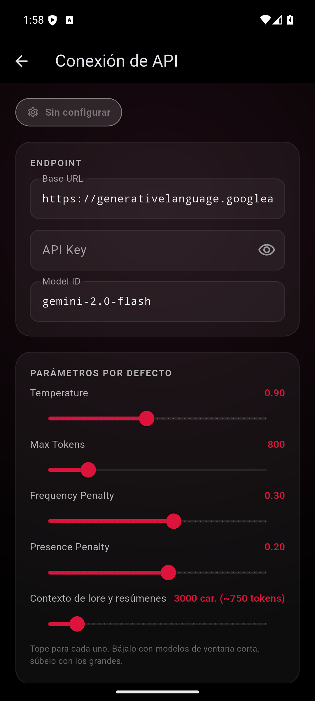

# Aura Novel

App móvil (Flutter, Android) para escribir novelas con ayuda de una IA. Hice la app para escribir en el celular sin depender de un servicio con suscripción: tú pones tu propia API key y el modelo que quieras.

  

## Qué hace

- **Editor** con contador de palabras y tiempo de lectura. El botón de continuar pide a la IA que siga la escena, y la instrucción rápida sirve para pedir ajustes ("aumenta la tensión"). Lo que escribe la IA queda marcado para aceptarlo o descartarlo (descartar devuelve el texto original), hay deshacer y rehacer, una meta de palabras por sesión y una estimación de los tokens gastados.
- **Autosave:** lo que escribes sin guardar versión se guarda como borrador cada pocos segundos y se recupera al volver a abrir el capítulo.
- **Proyectos y capítulos** guardados en SQLite local, y cada capítulo guarda su historial como un árbol de ramas (`story_nodes`): puedes bifurcar desde cualquier punto y volver a cargar una rama en el editor.
- **Estudio de personajes y lore:** fichas de personajes y de elementos del mundo. `ContextBuilderService` detecta en el texto reciente los nombres y etiquetas que aparecen, más lo que fuerces incluir, y los manda como contexto a la IA para que no se contradiga. El bloque tiene un tope de caracteres que se ajusta en Ajustes de API (3000 por defecto).
- **Resúmenes por capítulo:** un botón en la lista de capítulos le pide a la IA un resumen, y el editor lo manda como contexto al escribir los capítulos siguientes.
- **Exportar** a TXT, PDF o EPUB y compartir el archivo.
- **Copia de seguridad:** exporta proyectos, versiones y lore a un JSON y lo restaura desde Mis Proyectos. La API key no entra en la copia.
- **Ajustes de API:** cualquier servidor compatible con `POST {baseUrl}/chat/completions` de OpenAI. La key se guarda con `flutter_secure_storage`.

## Cómo correrla

```
flutter pub get
flutter run
```

Necesitas Flutter 3 y un dispositivo o emulador Android. En Ajustes de API pon la URL base, tu key y el nombre del modelo.

## Estado

Funciona en mi Galaxy S10+. Solo probé Android. La respuesta de la IA llega en streaming (SSE) y se reintenta sola si el servidor responde 429, 5xx o hay un corte de red antes de empezar.

Los tests están en `test/` (`flutter test`) y cubren el cliente, el contexto del lore, el export EPUB, los repositorios con sus migraciones, el autosave, los resúmenes y la copia de seguridad. La interfaz no tiene tests de widgets. La restauración de copias usa `file_picker` y no la he probado en el teléfono todavía.

Las decisiones de diseño están en [docs/decisions.md](docs/decisions.md).
